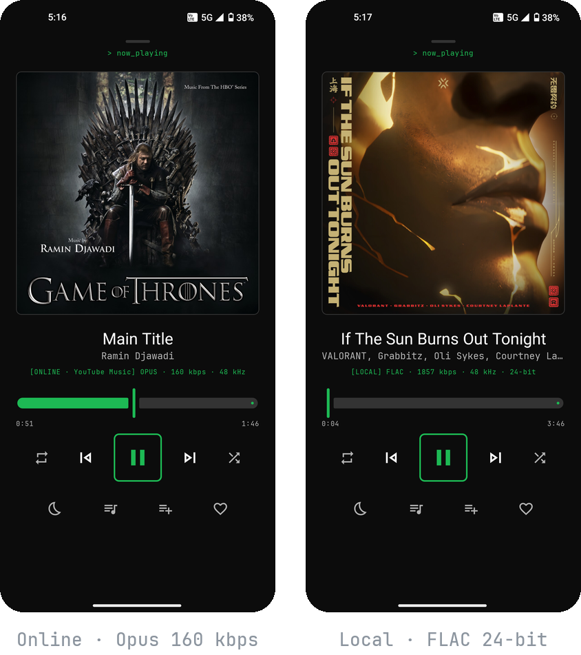

<div align="center">


# CLIBeats

**A free, open-source Android music player with a terminal-inspired interface.**<br>
Stream online or play your own lossless library — no ads, no accounts, no tracking.

[](#)
[](#downloads)
[](https://developer.android.com/)
[](https://kotlinlang.org/)
[](https://developer.android.com/compose)
[](LICENSE)



</div>

## Contents

- [Features](#features)
- [Gestures](#gestures)
- [Navigation](#navigation)
- [Architecture](#architecture)
- [Technology](#technology)
- [Build From Source](#build-from-source)
- [Project Structure](#project-structure)
- [Privacy & Legal](#privacy--legal)
- [Documentation](#documentation)
- [Contributing](#contributing)
- [Star History](#star-history)
- [Downloads](#downloads)
- [Developers](#developers)
- [License](#license)

---

## Features

### Playback
- **Queue playback that just works** — every queued song resolves when it's reached (skip, auto-advance, repeat).
- **Fast start** — playback begins after ~0.5 s of buffer; next 2 songs are pre-resolved and their covers prefetched.
- **Repeat** (off → all → one), with a tiny `ONE` / `ALL` / `OFF` label above the button.
- **Shuffle reorders the queue itself:** the playing song moves to the top and the rest is mixed, so the Queue screen,
  next and previous all follow what you see; turning it off restores the original order. A list started while shuffle
  is on plays shuffled.
- **Sleep timer** — 15 / 30 / 45 / 60 min or end of track (also with repeat-one).
- **Auto-queue related songs** (optional, off by default) — tapping a song queues the rest of that list after it.
- **Previous** restarts the song when it's more than 3 s in; press again for the song that played before — local or
  online, from any queue.
- **Next** after going back returns to the songs you went back from, in order, at any point in a song; otherwise it
  follows the queue. Previous and next work the same in the app, notification, lock screen and headphones.
- **Clear upcoming** keeps the song that's playing.
- Expired YouTube links are refreshed automatically; one silent retry on stream errors.
- **A song that can't be played is skipped** with a short notice above the player bar, so the queue never stalls.

### Sources
- **Online:** YouTube Music.
- **Local:** your own files — **FLAC (16/24-bit), WAV, MP3, M4A (AAC / ALAC), AAC, OGG Vorbis, Opus** (each checked
  with a real sample file in the tests; ALAC also needs the phone's decoder). AIFF isn't supported.
- **Data saver** — turn off *High quality streaming* (Settings → Audio Quality) to stream the lowest-bitrate audio.

### Home
- **Online:** *Trending in <your country>* (YouTube's daily top songs for the country your SIM / mobile network is
  in), then **Charts & Top 50** (Spotify's Top 50 Global and your country's, plus YouTube's charts), then rows for
  your languages, then YouTube Music's own feed (Quick picks, new releases, playlists), and last **your own rows**
  from what you play online (mixes, Jump back in, Your top artists, Forgotten gems, On repeat, Albums to revisit;
  clearing your history clears them too). **Mood chips** (Relax, Workout, …) filter it.
- **Languages:** pick the languages you listen to (33, from Arabic to Vietnamese); Home hides other languages and
  adds songs, playlists and Top 50 charts in yours.
- **Playlist, album and artist cards** open in the playlist view with ▶ Play, Shuffle and + Save as playlist.
  Spotify Top 50 cards find their songs on YouTube Music as they open.
- **Local:** mixes for the time of day and for your top artists (with the artists you play alongside them), Jump
  back in, Recently added, Your top artists, Forgotten gems, Never played and Albums to revisit, plus **Shuffle all**
  and **Surprise album**. With no music yet, Home offers to choose your music folder.
- `[ ↻ REFRESH ]` reloads the online page or reshuffles the local one.

### Local library
- Add **one or more music folders** (system picker, no storage permission); **Rescan** picks up changes.
- Title, artist, album, duration and cover art come from the **file tags**, not file names.
- **M3U / M3U8 / PLS playlists** in your folders appear as read-only `[LOCAL]` playlists
  (with **Save as app playlist** to make an editable copy).

### Library, playlists & favourites
- **Library** has three sections: **Playlists**, **Online** (songs you've played, with its own `[ CLEAR ]`) and
  **Local** (your device music), the last two as Tracks / Artists / Albums.
- **Artists and Albums** show as a grid, list or details with covers and play counts ("12 songs · 48 plays"),
  sorted by most played, most songs or A–Z. Tap one to open its songs (▶ Play, Shuffle); ▶ on a card plays it.
- **▶ on every playlist** plays it without opening it; inside a playlist, **▶ Play** and **Shuffle** sit at the top.
- **Playlists:** ♥ Favorites and Most Played pinned on top (each with a confirmed `[ CLEAR ALL ]`),
  then your playlists (`[ ↓ IMPORT ]`, `[ + NEW ]`), then local playlists in their own section. Four views — small
  grid, large grid, list and details — remembered between launches.
- **Edit a playlist** with the pencil: rename it, pick a cover from your phone or an image URL, or reset the cover.
- **Sort** a playlist's songs by title or artist, A–Z or Z–A; **Find** searches inside a playlist.
- **Hold a song to select several**, then play next, queue, download, add to a playlist, favourite or remove them.
- **Favourites:** heart in Now Playing, or swipe left on any song.
- **Recently Played** on Home (last 5), with its own `[ CLEAR ]` that doesn't touch the Library.
- **Recent searches:** with the search box empty, Search lists the songs you played, queued, favourited or added to
  a playlist from earlier searches.
- **Reorder** the queue, ♥ Favorites and your own playlists: drag a song's ≡ handle, or hold its cover and drag.
- **Playlist export / import** (`clibeats.json`, any location via the system picker) — includes Favorites.
- **Full backup:** saved automatically once a day, each day's replacing the last: playlists, Favorites, saved albums
  and artists, play history (Most played, Recently played), which songs are downloaded, and every setting. A copy goes
  to `Download/CLIBeats/clibeats-backup-DDMMYYYY.json` on Android 10+ so it survives an uninstall; setup offers to
  restore it. Settings → **Backup**: back up now, save a copy anywhere, restore, share. Restoring offers to download
  the downloaded songs again. Android's own backup also restores the library on a new phone.
- **Playlist views:** details, bigger details, grid or bigger grid (one icon cycles them, remembered); one-tap sort
  (Title / Artist, A→Z / Z→A) with a small pop-up.
- **Library Artists & Albums:** sort by Recent (default), Most played, Most songs or A–Z, each remembered.

### Import playlists
- **Library → Playlists → `[ ↓ IMPORT ]`** — choose **Spotify**, **YouTube Music** or **Others** (Apple Music,
  Amazon Music, Deezer, Tidal…) and follow the steps: export a file with
  [Exportify](https://exportify.net) or [TuneMyMusic](https://www.tunemymusic.com), then pick it.
- `.csv` or `.zip`, one or many playlists per file; tick the ones you want.
- Each song is found on YouTube Music by title, artist, album, length, language and ISRC. Nothing is guessed:
  songs it can't be sure of are listed with **Find** and **Copy** (copy the list as text). In **Find**, tap a
  result to play it and check it's the right one, then `[ + ]` to add it.
- Right language versions of film songs, album covers, live progress, a notification while it runs, and
  **Replace / Keep both** for existing playlists. Optional **Use the closest version**.

### Open links in CLIBeats
- **YouTube Music and Spotify links** open in CLIBeats once you allow it: Settings → Apps → CLIBeats →
  **Open by default → Add link**, tick the sites. Or **Share** a link to CLIBeats from any app.
- Songs play at once (a Spotify song is found on YouTube Music like an imported one); YouTube Music playlists and
  albums play as a queue; Spotify playlists and albums are imported (up to 100 songs from a link).

### Now Playing
- High-res cover art: the low-res thumbnail shows instantly and the full-quality cover fades in.
- Quality line: source + codec + bitrate + sample rate (+ bit depth for lossless), e.g.
  `[LOCAL] FLAC · 1857 kbps · 48 kHz · 24-bit` or `[ONLINE · YouTube Music] OPUS · 160 kbps · 48 kHz`.
- **Matches the album art:** a frosted-glass background made from the cover (blurred, under a readable wash; a tinted
  gradient on Android 11 and older), with the cover's vivid colour on the controls, fading between songs.
- **Waveform seek:** drag across the bars behind the controls to scrub. Playback keeps going, its position stays marked,
  and dragging back near it snaps onto it (letting go there doesn't seek).
- The quality line stays readable on any cover: a lighter shade of the album colour, or light amber (never red).
- **Audio output:** shows where the music is playing — phone speaker, wired headphones or your Bluetooth device by
  name — and follows changes as they happen. Tap it to open Android's output switcher.
- Repeat · previous · play/pause · next · shuffle, then sleep timer · queue · add to playlist · ♥.
- Dark or colourless covers use your theme colour for the highlights.
- **Lyrics:** swipe up on the cover (or tap the lyrics button) for syllable-synced, line-synced or plain lyrics.
  Local songs read the file's tags or a `.lrc` beside it; YouTube Music songs search LyricsPlus, BetterLyrics, LRCLIB,
  YouTube Music and lyrics.ovh at once and keep the best (syllable > line > plain). **文A Translate** and **abc
  Pronunciation** add each line's meaning and romanization. Lyrics load only when opened, are saved (downloads keep
  theirs offline), and Settings → Storage shows their size (2,000 songs kept).

### System integration
- **Background playback** and lock-screen / notification controls with **high-res artwork** from the image cache:
  a cached cover shows at once and the high-res one replaces it; missing sizes fall back to smaller ones, then the logo.
- **Repeat** and **♥ Favorite** buttons on the notification and lock screen, with the CLIBeats logo as its icon.
- Tapping the notification opens the app; the session survives swiping the app away.
- **Resume card** in Quick Settings after the app is closed (Android 11+): same queue, same song, same position.
- **In-app updates:** a pop-up when a new release is out (DOWNLOAD / LATER), checksum-verified download to
  Downloads with a progress bar above the player (`[VIEW]` / `[×]`), then INSTALL. Settings → Updates: auto-check
  daily / weekly / off and CHECK NOW.
- **Android Auto / AAOS:** Recently Played, Playlists, Library and Queue roots over the existing media library
  service, with voice search. Sideloaded builds need **Unknown sources** enabled in Android Auto's developer settings.
- **Equalizer on Now Playing:** volume and an **[ EQ ]** shortcut beside the song; the screen has a terminal
  response graph, animated waveform, 10 draggable bands (31 Hz – 16 kHz), presets, pre-amp and RESET. Android 9+
  uses `DynamicsProcessing`, Android 8 the platform `Equalizer`; **SYSTEM EQ** opens the phone's effects panel.
- **Discord:** opt-in "Listening to CLIBeats" card preview; publishing is gated on Discord's official Social SDK
  (see `docs/DISCORD_PRESENCE.md`) and never uses a user token.

### Storage & performance
- **Two caches, each with its own limit and `[ CLEAR ]`:** artwork (64 MB–512 MB) and songs (256 MB–2 GB);
  limit changes apply immediately.
- **Song cache:** streamed songs replay instantly without using data; local files are never duplicated.
- One shared thumbnail per cover, disk-cached images, lightweight list rendering.

### Interface
- Terminal-style UI (JetBrains Mono, bracketed controls, bordered blocks).
- **Themes:** a big **THEME** heading in Settings opens the colour scheme (System · Light · Dark · AMOLED, shown as
  previews) and six themes — Classic, Berry, Grove, Ocean, Ember, Iris — each tinting the whole app in a light and a
  dark version, plus **Create theme** from any colour. Nine accent colours and a **custom colour picker** work on top.
- **Mini player seek:** touch or drag the bar; a bubble shows the exact time, and it lands on that second.
- **First-run setup** (new installs): theme → music folder → default source (Online / Local).
- **App icon:** round logo (terminal prompt and spectrum bars) that fits round, squircle and square icon shapes, with a themed (monochrome) variant on Android 13+.

---

## Gestures

**Songs** (in any list)

| Gesture | Action |
|---|---|
| Tap | Play |
| **Swipe right** | Add to queue (changeable in Settings → Gestures) |
| **Swipe left** | Add to ♥ Favorites (changeable in Settings → Gestures) |
| **Hold** | Menu: Play next · Add to queue · Add to playlist · Add to favorites |
| Drag ≡, or hold the cover and drag | Reorder (queue, ♥ Favorites, your playlists) |

**Queue**

| Gesture | Action |
|---|---|
| **Swipe right** on a song | Remove it, with **Undo** (changeable in Settings → Gestures) |
| Queue button in the mini player | Open the queue · tap again to go back |

**Bottom bar**

| Gesture | Action |
|---|---|
| Swipe left / right outside a song row | Next / previous tab |
| Tap **Home** again | Close a playlist opened from Home, then switch Online ↔ Local |
| Tap **Search** again · **double-tap** | Switch Online ↔ Local · open the keyboard |
| Tap **Library** again | Leave the open playlist / artist / album, then Artists or Albums → Tracks, then Playlists → Online → Local |

Every swipe can be changed or turned off in **Settings → Gestures**: song swipes can add to queue, play next, add
to ♥ Favorites, add to a playlist or do nothing; the Queue's swipe can remove (default) or do any of those; tab
swiping and Now Playing's swipes can be switched off. The ↺ icon restores the defaults.

**Player**

| Gesture | Action |
|---|---|
| Tap the mini player | Open Now Playing |
| Touch / drag the mini player's bar | Seek, with the exact time shown |
| **Drag down** on the cover (Now Playing) | Close the player |
| **Swipe up** on the cover (Now Playing) | Switch between cover and lyrics |
| **Drag** across the waveform | Scrub; near the current time it snaps back |
| Previous: tap · tap again | Restart the song · the song before |
| Next after going back | Return to the song you went back from |
| Repeat | Off → All → One |
| Tap the audio output | Android's output switcher |
| Back | Close the player / playlist, then return to Home |

---

## Navigation

```
 Home   Search   Library   Settings
```

- **Home** — online: trending, charts & Top 50, your languages and YouTube Music's feed; local: mixes and
  rediscovery rows from your library.
- **Search** — search YouTube Music or your device; online results include **playlists** (those on your Home
  first); hold a result for more options.
- **Library** — **Playlists** (Favorites, Most Played, your playlists, import, local M3U), **Online** (played songs)
  and **Local** (device music: Tracks / Artists / Albums).
- **Settings** — theme & accent, local music folders, playback, storage, backup, updates, about.
- **Queue** opens full screen from the mini player's queue button (also from Now Playing).

---

## Architecture

```text
presentation (Compose screens + ViewModels)
        │
domain (models, repository & provider interfaces)
        │
data (providers, Room, DataStore, scanner, caches)  ──  playback (ExoPlayer, MediaLibraryService)
```

- **Providers** implement one `MusicProvider` interface (search, trending, stream), so sources are interchangeable.
- **Lazy stream resolution:** queue items carry a `clibeats://track?...` placeholder that a Media3
  `ResolvingDataSource` turns into a real URL (or cached file) only when played.
- **Song cache:** Media3 `SimpleCache` keyed per track, with an adjustable LRU limit; local files bypass it.
- **Local scanner:** SAF `DocumentsContract` walk + `MediaMetadataRetriever` tags; M3U/PLS parsed into read-only playlists.
- **System controls:** `MediaLibraryService` (notification, lock screen, resume card via the recent-item browse root).

---

## Technology

Kotlin · Jetpack Compose (Material 3) · Media3 ExoPlayer & Session · Hilt · Room · DataStore ·
Retrofit / OkHttp · kotlinx.serialization · Coil · NewPipeExtractor · JUnit / Mockito / Truth / Paparazzi ·
ktlint · detekt.

---

## Build From Source

**Requirements:** Android 8.0 (API 26)+ to run · JDK 17 and Android SDK 34 to build.

```bash
git clone https://github.com/Omprakash-p06/clibeats.git
cd clibeats
```

```powershell
.\gradlew.bat testDebugUnitTest      # unit tests
.\gradlew.bat ktlintCheck detekt     # style & static analysis
.\gradlew.bat lintDebug              # Android Lint
.\gradlew.bat assembleDebug          # debug APK  -> app/build/outputs/apk/debug/
.\gradlew.bat assembleRelease        # release APK -> app/build/outputs/apk/release/
```

Screenshot tests: `.\gradlew.bat verifyPaparazziDebug` (needs `ANDROID_HOME` set).

### Releases

Download the latest APK from [Releases](https://github.com/Omprakash-p06/clibeats/releases): each release has
`CLIBeats-vX.Y.Z.apk` and a `SHA256SUMS.txt` to verify it (`sha256sum -c SHA256SUMS.txt`, or
`Get-FileHash CLIBeats-v2.5.2.apk` on Windows). From v2.1.0 the app updates itself (Settings → Updates).
Every release is signed with the CLIBeats key, certificate SHA-256
`bef6949089c552944cc9691d543326d42537a20eef163bb3961b30dbd146b26a`.

Pushing a tag like `v2.5.2` runs `.github/workflows/release.yml`: tests, a signed release APK and a GitHub
Release with [release notes](docs/RELEASE_NOTES.md). Signing uses the repository secrets `KEYSTORE_BASE64`,
`KEYSTORE_PASSWORD`, `KEY_ALIAS` and `KEY_PASSWORD`; the workflow stops if they're missing, so a
debug-signed APK (which couldn't update existing installs) is never published. A release published by hand is
left untouched. The version comes from the tag (`2.5.2` → versionCode `20502`); local builds default to 2.5.2.

---

## Project Structure

```text
app/src/main/java/com/clibeats/
├── data/          # providers (YouTube Music, local), Room, DataStore,
│                  # scan (local scanner, M3U parser), cache (song/artwork caches), playlist exchange
├── domain/        # models, repository + provider interfaces
├── playback/      # PlayerAdapter, StreamResolver, TrackUriResolver, PlaybackService
├── presentation/  # home, search, library, queue, playlist, player, settings, onboarding, theme, components
└── di/            # Hilt modules
docs/              # screenshots, ADRs, user guide, release notes, licenses
logo/              # app logo (SVG source of the launcher icon + PNG)
```

---

## Privacy & Legal

**Privacy.** CLIBeats is local-first: no CLIBeats account and no CLIBeats backend. Library, playlists, favourites,
queue and history are stored on the device. Online providers receive the requests needed to search and
stream; their own policies apply.

**Legal.** CLIBeats does not host or provide music. Availability depends on the selected provider. Users are
responsible for complying with providers' terms of service and copyright law in their jurisdiction.

---

## Documentation

- [User Guide](docs/USER_GUIDE.md)
- [Release Notes](docs/RELEASE_NOTES.md)
- [Architecture Decision Records](docs/adr/)
- [Third-party Licenses](docs/LICENSES.md)

---

## Contributing

1. Keep provider-specific logic out of the domain layer.
2. Add or update tests for behaviour changes.
3. Run the quality gates (tests, ktlint, detekt, lint) before opening a PR.
4. Keep UI changes consistent with the terminal design system.

---

## Star History

<a href="https://star-history.com/#Omprakash-p06/clibeats&Date">
  <picture>
    <source media="(prefers-color-scheme: dark)" srcset="https://api.star-history.com/svg?repos=Omprakash-p06/clibeats&type=Date&theme=dark" />
    <source media="(prefers-color-scheme: light)" srcset="https://api.star-history.com/svg?repos=Omprakash-p06/clibeats&type=Date" />
    
  </picture>
</a>

---

## Downloads

Total APK downloads across all releases, updated daily. These count downloads, not people: installing
and later updating counts each download, and the checksum file the in-app updater fetches isn't counted.


---

## Developers

Developed by **[Omprakash Panda](https://github.com/Omprakash-p06)** and
**[Aditya Krishnamurthy](https://github.com/AdityaKrishnamurthy)**.

---

## License

CLIBeats is distributed under the MIT License — see [LICENSE](LICENSE).
