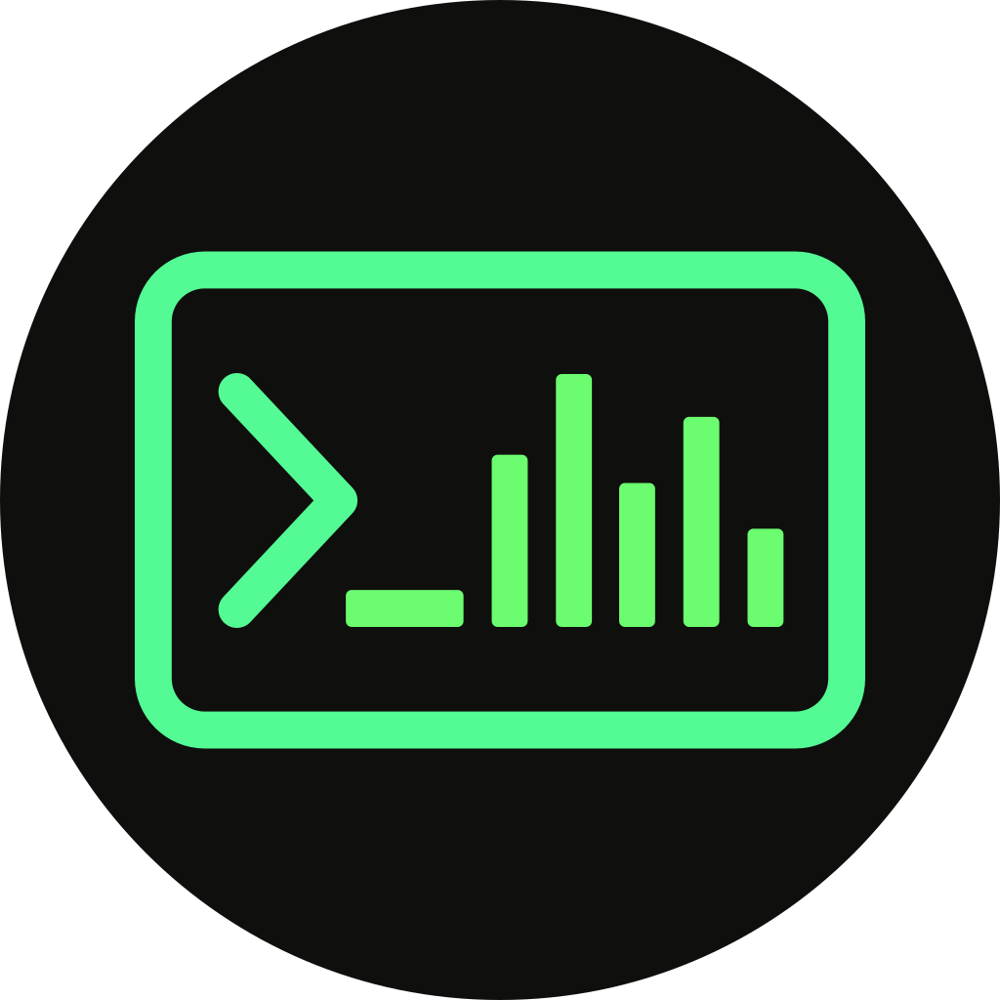
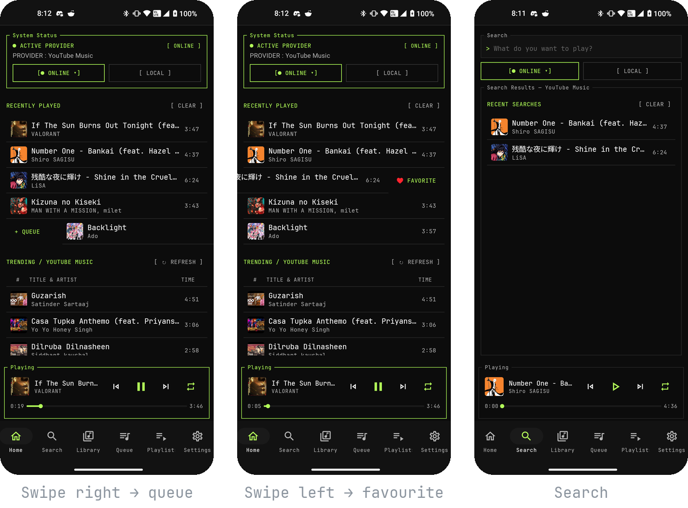
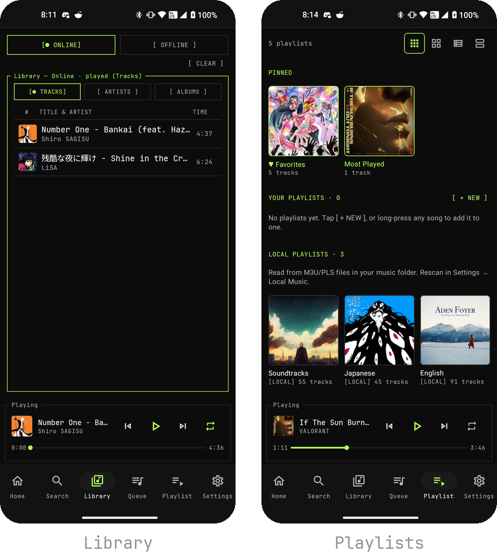

<div align="center">



# CLIBeats

**A free, open-source Android music player with a terminal-inspired interface.**<br>
Stream online or play your own lossless library — no ads, no accounts, no tracking.

[](#)
[](#downloads)
[](https://developer.android.com/)
[](https://kotlinlang.org/)
[](https://developer.android.com/compose)
[](LICENSE)


</div>

## Contents

- [Screenshots](#screenshots)
- [Features](#features)
- [Gestures](#gestures)
- [Navigation](#navigation)
- [Architecture](#architecture)
- [Technology](#technology)
- [Build From Source](#build-from-source)
- [Project Structure](#project-structure)
- [Privacy & Legal](#privacy--legal)
- [Documentation](#documentation)
- [Contributing](#contributing)
- [Star History](#star-history)
- [Downloads](#downloads)
- [Developers](#developers)
- [License](#license)

---

## Screenshots

**Home & Search** — swipe a song right to queue it or left to favourite it; recent searches when the box is empty.



**Library & Playlists** — songs you've played online; playlists with Favorites and Most Played pinned on top.



**Settings** — theme, accent colours (with a custom picker), music folders, caches, backup and updates.


---

## Features

### Playback
- **Queue playback that just works** — every queued song resolves when it's reached (skip, auto-advance, repeat).
- **Fast start** — playback begins after ~0.5 s of buffer; next 2 songs are pre-resolved and their covers prefetched.
- **Repeat** (off → all → one), with a tiny `ONE` / `ALL` / `OFF` label above the button.
- **Shuffle reorders the queue itself:** the playing song moves to the top and the rest is mixed, so the Queue screen,
  next and previous all follow what you see; turning it off restores the original order. A list started while shuffle
  is on plays shuffled.
- **Sleep timer** — 15 / 30 / 45 / 60 min or end of track (also with repeat-one).
- **Auto-queue related songs** (optional, off by default) — tapping a song queues the rest of that list after it.
- **Previous** restarts the song when it's more than 3 s in; press again for the song that played before — local or
  online, from any queue.
- **Next** after going back returns to the songs you went back from, in order, at any point in a song; otherwise it
  follows the queue. Previous and next work the same in the app, notification, lock screen and headphones.
- **Clear upcoming** keeps the song that's playing.
- Expired YouTube links are refreshed automatically; one silent retry on stream errors.
- **A song that can't be played is skipped** with a short notice above the player bar, so the queue never stalls.

### Sources
- **Online:** YouTube Music, Internet Archive, Jamendo, Audius — pick from the `ONLINE ▾` drop-down.
- **Local:** your own files — **FLAC (16/24-bit), WAV, MP3, M4A (AAC / ALAC), AAC, OGG Vorbis, Opus** (each checked
  with a real sample file in the tests; ALAC also needs the phone's decoder). AIFF isn't supported.
- **Trending by country** — Home shows YouTube Music's own chart for the country your SIM / mobile network is in
  (e.g. *Daily Top Music Videos – India*). It loads once per app open; `[ ↻ REFRESH ]` reloads it.
- **Data saver** — turn off *High quality streaming* (Settings → Audio Quality) to stream the lowest-bitrate audio.

### Local library
- Add **one or more music folders** (system picker, no storage permission); **Rescan** picks up changes.
- Title, artist, album, duration and cover art come from the **file tags**, not file names.
- **M3U / M3U8 / PLS playlists** in your folders appear as read-only `[LOCAL]` playlists
  (with **Save as app playlist** to make an editable copy).

### Library, playlists & favourites
- **Library:** `[ ONLINE ]` shows only songs you've played (with its own `[ CLEAR ]`); `[ OFFLINE ]` shows your device music and its track count. Tracks / Artists / Albums.
- **Playlists:** ♥ Favorites and Most Played pinned on top (each with ✕ per song and a confirmed `[ CLEAR ALL ]`),
  then your playlists (`[ + NEW ]`), then local playlists in their own section. Four views — small grid, large grid,
  list and details — remembered between launches.
- **Custom covers:** tap a playlist's cover to pick an image from your phone or paste an image URL; reset any time.
- **Favourites:** heart in Now Playing, or swipe left on any song.
- **Recently Played** on Home (last 5), with its own `[ CLEAR ]` that doesn't touch the Library.
- **Recent searches:** with the search box empty, Search lists the songs you played, queued, favourited or added to
  a playlist from earlier searches.
- **Reorder** the queue, ♥ Favorites and your own playlists: drag a song's ≡ handle, or hold its cover and drag.
- **Playlist export / import** (`clibeats.json`, any location via the system picker) — includes Favorites.
- **Library backup:** saved automatically once a day (playlists, Favorites, saved albums and artists, settings), also to
  `Download/CLIBeats` on Android 10+ so it survives an uninstall. Setup offers to restore it; **SHARE BACKUP** in
  Settings sends a copy anywhere. Android's own backup also restores the library on a new phone.

### Now Playing
- High-res cover art: the low-res thumbnail shows instantly and the full-quality cover fades in.
- Quality line: source + codec + bitrate + sample rate (+ bit depth for lossless), e.g.
  `[LOCAL] FLAC · 1857 kbps · 48 kHz · 24-bit` or `[ONLINE · YouTube Music] OPUS · 160 kbps · 48 kHz`.
- **Matches the album art:** a frosted-glass background made from the cover (blurred, under a readable wash; a tinted
  gradient on Android 11 and older), with the cover's vivid colour on the controls, fading between songs.
- **Waveform seek:** drag across the bars behind the controls to scrub. Playback keeps going, its position stays marked,
  and dragging back near it snaps onto it (letting go there doesn't seek).
- The quality line stays readable on any cover: a lighter shade of the album colour, or light amber (never red).
- **Audio output:** shows where the music is playing — phone speaker, wired headphones or your Bluetooth device by
  name — and follows changes as they happen. Tap it to open Android's output switcher.
- Repeat · previous · play/pause · next · shuffle · sleep timer · queue (`[ QUEUE (n) ]`) · add to playlist · ♥.

### System integration
- **Background playback** and lock-screen / notification controls with **high-res artwork** from the image cache:
  a cached cover shows at once and the high-res one replaces it; missing sizes fall back to smaller ones, then the logo.
- Tapping the notification opens the app; the session survives swiping the app away.
- **Resume card** in Quick Settings after the app is closed (Android 11+): same queue, same song, same position.
- **In-app updates:** a pop-up when a new release is out (DOWNLOAD / LATER), checksum-verified download to
  Downloads with a progress bar under the top bar (`[VIEW]` / `[×]`), then INSTALL. Settings → Updates: auto-check
  daily / weekly / off and CHECK NOW.

### Storage & performance
- **Two caches, each with its own limit and `[ CLEAR ]`:** artwork (64 MB–512 MB) and songs (256 MB–2 GB);
  limit changes apply immediately.
- **Song cache:** streamed songs replay instantly without using data; local files are never duplicated.
- One shared thumbnail per cover, disk-cached images, lightweight list rendering.

### Interface
- Terminal-style UI (JetBrains Mono, bracketed controls, bordered blocks).
- **Themes:** Dark · AMOLED · **Light**, with nine accent colours plus a **custom colour picker** (hue, saturation,
  brightness or a hex code); dialogs and menus follow the theme.
- **Mini player seek:** touch or drag the bar; a bubble shows the exact time, and it lands on that second.
- **First-run setup** (new installs): theme → music folder → default source (Online / Local).
- **App icon:** round logo (terminal prompt and spectrum bars) that fits round, squircle and square icon shapes, with a themed (monochrome) variant on Android 13+.

---

## Gestures

| Where | Gesture | Action |
|---|---|---|
| Anywhere outside a song row | Swipe left / right | Next / previous tab (Home → Search → Library → Queue → Playlists → Settings) |
| Any song row | **Swipe right** | Add to queue (`+ QUEUE`) |
| Any song row | **Swipe left** | Add to ♥ Favorites (`♥ FAVORITE`) |
| Any song row | **Long-press** | Add to playlist (with inline "+ New playlist") |
| Bottom bar · **Home** | Tap again (on Home) | Switch the source Online ↔ Local |
| Bottom bar · **Search** | Tap again (on Search) | Switch the source Online ↔ Local |
| Bottom bar · **Search** | **Double-tap** | Focus the search box and open the keyboard |
| Bottom bar · **Library** | Tap again (on Library) | Switch Online ↔ Offline |
| Bottom bar · **Playlists** | Tap again (inside a playlist) | Back to the playlist grid |
| Mini player | Tap song / artwork | Open Now Playing |
| Mini player | Touch / drag the seek bar | Seek, with the exact time shown while held |
| Now Playing | **Drag down** on the artwork | Close the player |
| Queue · ♥ Favorites · your playlists | Drag a song's ≡ handle, or **hold its cover** and drag | Reorder |
| Previous button | Tap (more than 3 s in) · tap again | Restart the song · play the one before |
| Next button | Tap after going back | Return to the song you went back from |
| Now Playing | Tap the audio output (`[ ᛒ EARBUDS ]`) | Open Android's output switcher |
| Now Playing | **Drag** across the waveform | Scrub; back near the current time snaps to it |
| Repeat button | Tap repeatedly | Off → All → One |
| Playlist tile | Long-press | Delete playlist (app playlists only) |
| Back | — | Close player / playlist, then return to Home |

---

## Navigation

```
 Home   Search   Library   Queue   Playlists   ⚙ Settings
```

- **Home** — source switch, recently played, trending, mini player.
- **Search** — search the active source; play next / add to playlist / add to queue on each result.
- **Library** — Online (played) / Offline (device) · Tracks / Artists / Albums.
- **Queue** — the playing song, then Up Next to reorder, remove, shuffle or clear; tap to jump. Also opens from
  `[ QUEUE ]` in Now Playing.
- **Playlists** — Favorites and Most Played pinned, your playlists, local M3U playlists; grid / list / details views;
  drag ≡ (or hold a cover) to reorder Favorites and your playlists.
- **Settings** — theme & accent, local music folders, playback, provider, storage, playlist exchange & backup, about.

---

## Architecture

```text
presentation (Compose screens + ViewModels)
        │
domain (models, repository & provider interfaces)
        │
data (providers, Room, DataStore, scanner, caches)  ──  playback (ExoPlayer, MediaLibraryService)
```

- **Providers** implement one `MusicProvider` interface (search, trending, stream), so sources are interchangeable.
- **Lazy stream resolution:** queue items carry a `clibeats://track?...` placeholder that a Media3
  `ResolvingDataSource` turns into a real URL (or cached file) only when played.
- **Song cache:** Media3 `SimpleCache` keyed per track, with an adjustable LRU limit; local files bypass it.
- **Local scanner:** SAF `DocumentsContract` walk + `MediaMetadataRetriever` tags; M3U/PLS parsed into read-only playlists.
- **System controls:** `MediaLibraryService` (notification, lock screen, resume card via the recent-item browse root).

---

## Technology

Kotlin · Jetpack Compose (Material 3) · Media3 ExoPlayer & Session · Hilt · Room · DataStore ·
Retrofit / OkHttp · kotlinx.serialization · Coil · NewPipeExtractor · JUnit / Mockito / Truth / Paparazzi ·
ktlint · detekt.

---

## Build From Source

**Requirements:** Android 8.0 (API 26)+ to run · JDK 17 and Android SDK 34 to build.

```bash
git clone https://github.com/Omprakash-p06/clibeats.git
cd clibeats
```

```powershell
.\gradlew.bat testDebugUnitTest      # unit tests
.\gradlew.bat ktlintCheck detekt     # style & static analysis
.\gradlew.bat lintDebug              # Android Lint
.\gradlew.bat assembleDebug          # debug APK  -> app/build/outputs/apk/debug/
.\gradlew.bat assembleRelease        # release APK -> app/build/outputs/apk/release/
```

Screenshot tests: `.\gradlew.bat verifyPaparazziDebug` (needs `ANDROID_HOME` set).

### Releases

Download the latest APK from [Releases](https://github.com/Omprakash-p06/clibeats/releases): each release has
`CLIBeats-vX.Y.Z.apk` and a `SHA256SUMS.txt` to verify it (`sha256sum -c SHA256SUMS.txt`, or
`Get-FileHash CLIBeats-v2.4.0.apk` on Windows). From v2.1.0 the app updates itself (Settings → Updates).
Every release is signed with the CLIBeats key, certificate SHA-256
`bef6949089c552944cc9691d543326d42537a20eef163bb3961b30dbd146b26a`.

Pushing a tag like `v2.4.0` runs `.github/workflows/release.yml`: tests, a signed release APK and a GitHub
Release with [release notes](docs/RELEASE_NOTES.md). Signing uses the repository secrets `KEYSTORE_BASE64`,
`KEYSTORE_PASSWORD`, `KEY_ALIAS` and `KEY_PASSWORD`; the workflow stops if they're missing, so a
debug-signed APK (which couldn't update existing installs) is never published. A release published by hand is
left untouched. The version comes from the tag (`2.4.0` → versionCode `20400`); local builds default to 2.4.0.

---

## Project Structure

```text
app/src/main/java/com/clibeats/
├── data/          # providers (YouTube, IA, Jamendo, Audius, local), Room, DataStore,
│                  # scan (local scanner, M3U parser), cache (song/artwork caches), playlist exchange
├── domain/        # models, repository + provider interfaces
├── playback/      # PlayerAdapter, StreamResolver, TrackUriResolver, PlaybackService
├── presentation/  # home, search, library, queue, playlist, player, settings, onboarding, theme, components
└── di/            # Hilt modules
docs/              # screenshots, ADRs, user guide, release notes, licenses
logo/              # app logo (SVG source of the launcher icon + PNG)
```

---

## Privacy & Legal

**Privacy.** CLIBeats is local-first: no CLIBeats account and no CLIBeats backend. Library, playlists, favourites,
queue and history are stored on the device. Online providers receive the requests needed to search and
stream; their own policies apply.

**Legal.** CLIBeats does not host or provide music. Availability depends on the selected provider. Users are
responsible for complying with providers' terms of service and copyright law in their jurisdiction.

---

## Documentation

- [User Guide](docs/USER_GUIDE.md)
- [Release Notes](docs/RELEASE_NOTES.md)
- [Architecture Decision Records](docs/adr/)
- [Third-party Licenses](docs/LICENSES.md)

---

## Contributing

1. Keep provider-specific logic out of the domain layer.
2. Add or update tests for behaviour changes.
3. Run the quality gates (tests, ktlint, detekt, lint) before opening a PR.
4. Keep UI changes consistent with the terminal design system.

---

## Star History

<a href="https://star-history.com/#Omprakash-p06/clibeats&Date">
  <picture>
    <source media="(prefers-color-scheme: dark)" srcset="https://api.star-history.com/svg?repos=Omprakash-p06/clibeats&type=Date&theme=dark" />
    <source media="(prefers-color-scheme: light)" srcset="https://api.star-history.com/svg?repos=Omprakash-p06/clibeats&type=Date" />
    
  </picture>
</a>

---

## Downloads

Total APK downloads across all releases, updated daily. These count downloads, not people: installing
and later updating counts each download, and the checksum file the in-app updater fetches isn't counted.


---

## Developers

Developed by **[Omprakash Panda](https://github.com/Omprakash-p06)** and
**[Aditya Krishnamurthy](https://github.com/AdityaKrishnamurthy)**.

---

## License

CLIBeats is distributed under the MIT License — see [LICENSE](LICENSE).
